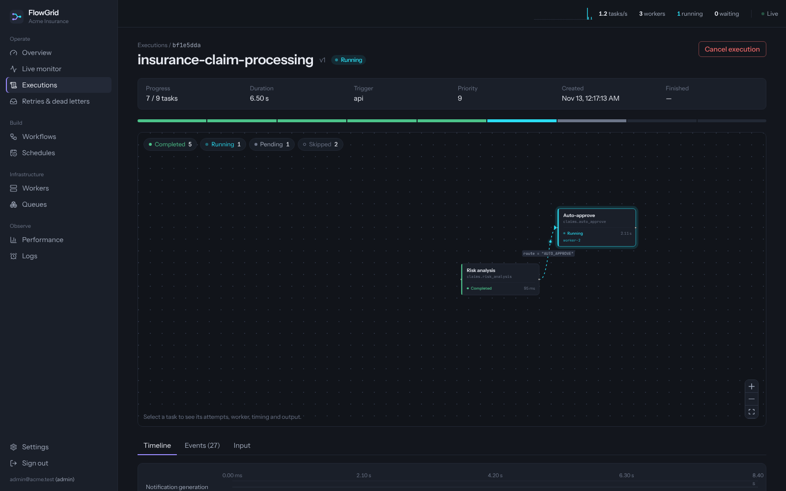
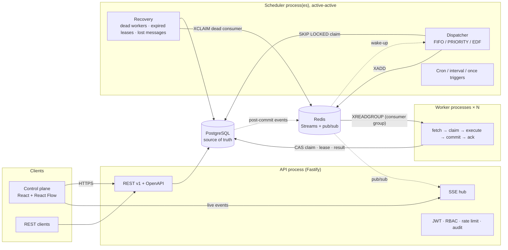
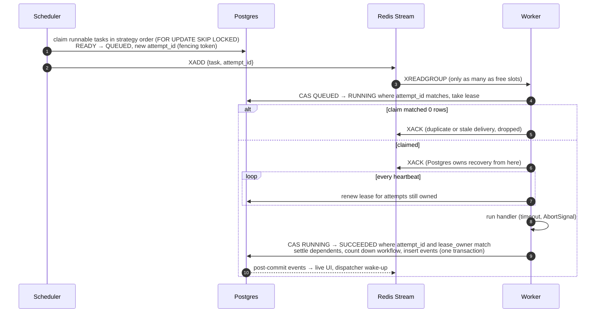
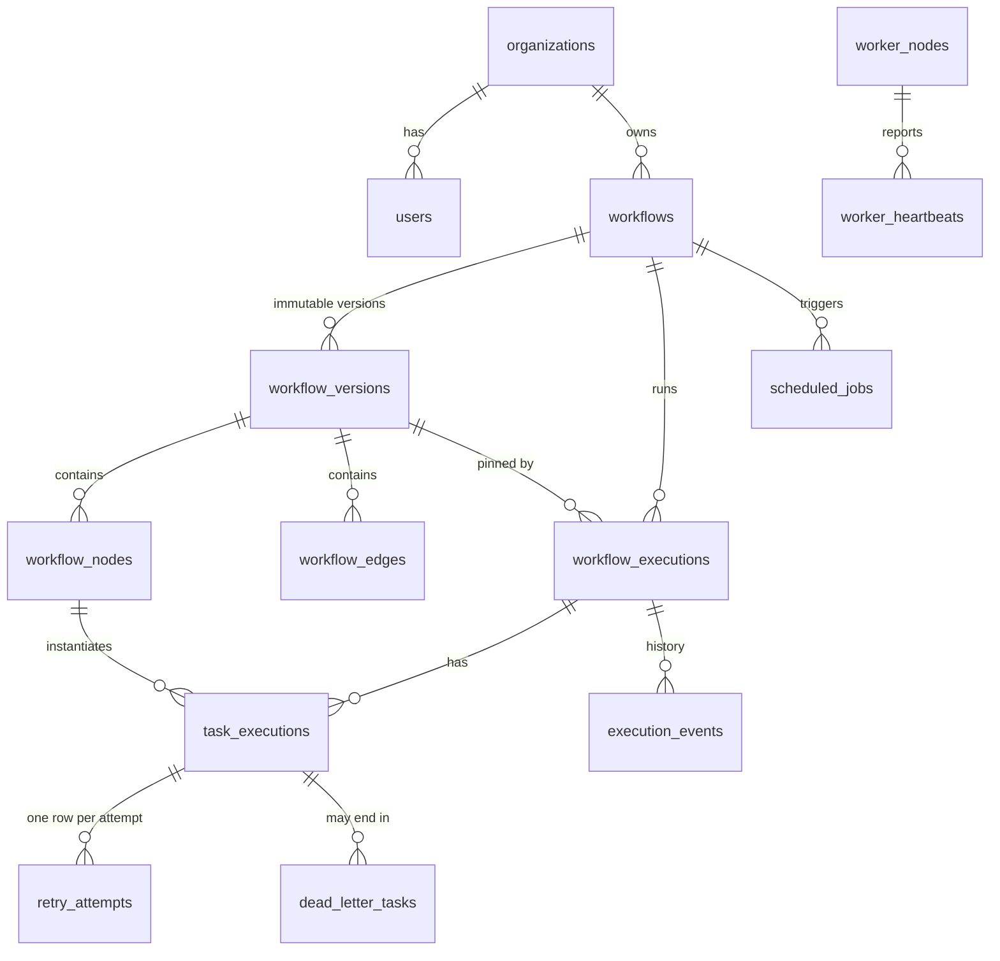
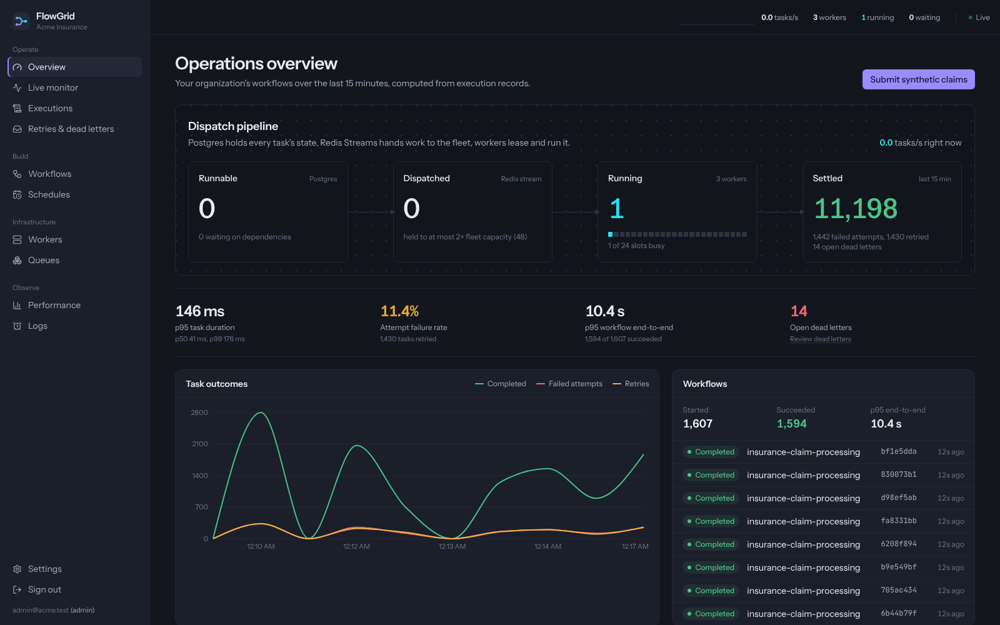
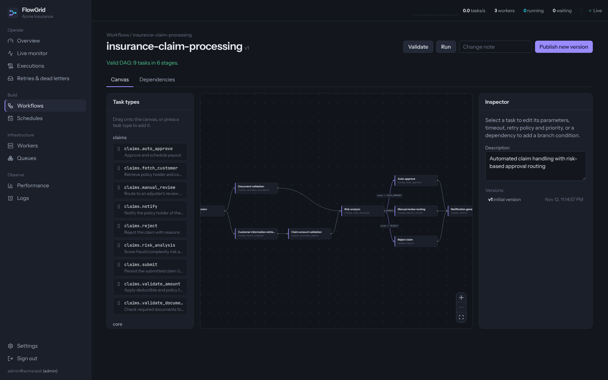
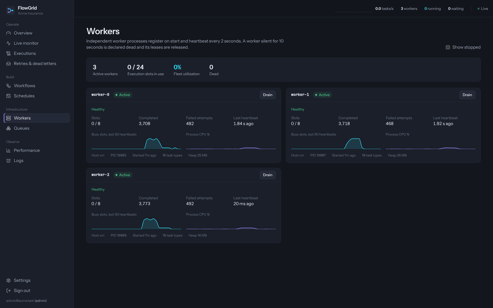
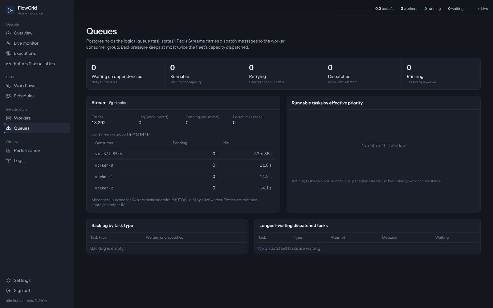
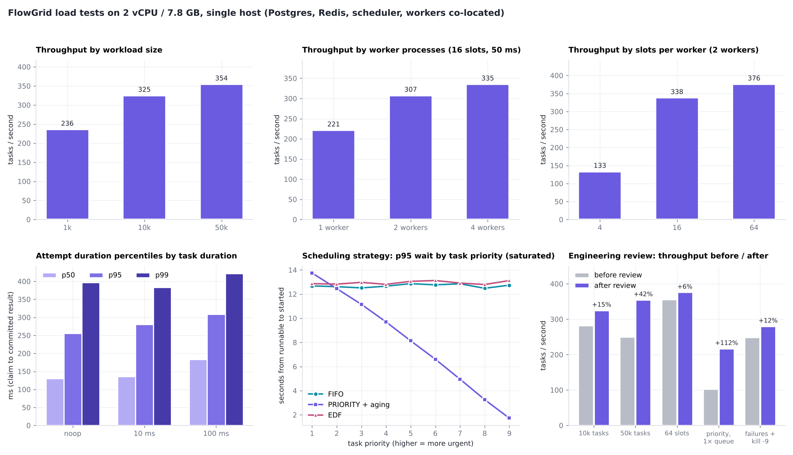

# FlowGrid: distributed workflow engine

FlowGrid defines, schedules, executes and monitors workflows made of dependent tasks (DAGs) across independent worker
processes. Postgres is the source of truth for every state transition, Redis Streams hands work to the workers, and a
live control plane shows each execution moving through its graph in real time.

It is built to survive the failures that break most background-job systems: workers killed mid-task, a scheduler
restart, Redis losing its data, dropped database connections, duplicate deliveries. It stays honest about what it
guarantees. **Delivery is at-least-once, results commit at most once per attempt, and business effects are
effectively-once through idempotency keys.**



## Contents

[Problem](#problem) · [Architecture](#architecture) · [DAG execution](#dag-execution) · [Scheduling](#scheduling) ·
[Queue and delivery semantics](#queue-and-delivery-semantics) · [Failure recovery](#failure-recovery) ·
[Concurrency model](#concurrency-model) · [Database](#database) · [API](#api) · [Control plane](#control-plane) ·
[Run it](#run-it) · [Tests](#tests) · [Benchmarks](#benchmarks) · [Trade-offs](#engineering-trade-offs)

## Problem

Background workflows run claims processing, payments, reporting and notifications. The usual implementations fail in
familiar ways: a job runs twice and charges twice, a server restart loses the task it was holding, retries hammer a
dependency that is already down, a stuck worker silently holds work forever, and nobody can see where a workflow is
stuck. FlowGrid treats each of those as a design requirement with a test that proves it.

## Architecture

One codebase, three process roles (`FLOWGRID_ROLE=api|scheduler|worker`), deployed as separate processes. They fail and
scale differently: a misbehaving handler can crash a worker but never the API, and workers scale out on their own.



| Component | Responsibility | Code |
|---|---|---|
| Workflow service | Validate DAGs (cycles, unknown task types, policy bounds), publish immutable versions | `workflows.ts`, `dag.ts` |
| Execution service | Instantiate a pinned version as task rows; cancel, resume, reschedule; queries | `executions.ts` |
| Task state machine | Every transition as a compare-and-set; dependency propagation; fail-fast; dead letters | `taskStore.ts` |
| Scheduler | Strategy-ordered dispatch with backpressure; dead-worker detection; lease reaping; redispatch; cron | `scheduler.ts`, `schedules.ts` |
| Worker runtime | Bounded concurrency; ownership claim; timeouts; heartbeats and lease renewal; graceful drain | `worker.ts` |
| Queue adapter | Redis Streams consumer group, acks, `XAUTOCLAIM`, poison-message DLQ stream | `queue.ts` |
| Monitoring | Prometheus metrics per process, structured JSON logs, read models for the console | `metrics.ts`, `api.ts` |
| Auth layer | HS256 JWT (stdlib), scrypt hashes, roles, tenant isolation, rate limiting, audit trail | `auth.ts`, `api.ts` |
| Demo applications | Insurance claims, month-end reporting, document pipeline, on the same engine | `handlers.ts`, `demo.ts` |

### Life of a task



## DAG execution

A workflow version is a set of tasks and edges. Each task carries an execution function (`type`), parameters, a timeout,
a retry policy (attempts, base and maximum backoff), a priority, an optional deadline and a trigger rule.

- **Validation:** Kahn's algorithm, level by level, gives the topological order and the parallel levels in O(V + E). If it
  cannot consume every node there is a cycle, and an iterative DFS reports one concrete cycle path
  (`cyclic dependency detected: a -> b -> c -> a`). Cyclic workflows are rejected at the API.
- **Dependency resolution at run time:** every task row has a `pending_deps` counter and a `satisfied_deps` counter.
  When a task settles, one `UPDATE` decrements its dependents' counters. A dependent whose last dependency settled becomes
  `READY` if its trigger rule holds, or `SKIPPED` if it never can (skips cascade).
- **Branching:** edges can carry a guard evaluated on the upstream output (`{"path": "route", "op": "EQ", "value": "AUTO_APPROVE"}`;
  operators `eq neq gt gte lt lte in exists truthy`). `ALL_SUCCESS` needs every incoming edge taken; `ANY_SUCCESS` joins after a branch.
- **Parallelism:** independent branches are runnable at the same time and execute on whatever slots are free, across processes.
- **Data flow:** a task receives its parameters, the execution input and the outputs of completed tasks.
- **Workflow status:** an atomic countdown of unsettled tasks; the transaction that reaches zero finalises the workflow.
  A task that fails for good dead-letters and fails the workflow fast (remaining tasks cancelled).
- **Workflow retry** resumes in place: succeeded tasks keep their outputs, everything else is re-derived in topological
  order (branch guards are re-evaluated) with a fresh attempt budget.
- **Versioning:** every edit publishes an immutable version (no-op edits are detected by checksum). Executions pin the
  version they started on, so editing a workflow never changes a run in flight. Editors use optimistic concurrency (`expectedLockVersion`).

## Scheduling

Immediate, delayed (`delaySeconds` / `runAt`, reschedulable while pending), recurring (`CRON` with time zones,
`INTERVAL`), one-off (`ONCE`), priority-based, dependency-based, cancellation and manual triggers.

The runnable set lives in Postgres and is ordered by a **partial B-tree index per strategy**. The index is the durable
priority queue: it survives scheduler crashes and lets several schedulers dispatch concurrently with `FOR UPDATE SKIP LOCKED`.

| Strategy | Order | Pick next k | Good at | Weakness |
|---|---|---|---|---|
| FIFO | `ready_at` | O(log n + k) | Fairness, predictability | Urgent work waits behind old work |
| PRIORITY | `effective_priority desc, ready_at` | O(log n + k) | Urgent work first | Starvation, mitigated by **aging** (+1 effective priority per `agingSeconds` waited, capped at 10; an indexed `UPDATE` every 5 s) |
| EDF | `deadline_at nulls last, priority` | O(log n + k) | Fewest deadline misses when load is feasible | Collapses under overload (one late task makes the next late) |

The strategy is a cluster-wide setting (Settings screen or `PUT /api/v1/scheduler/config`) that every scheduler picks up within 2 s.

**Backpressure:** the dispatcher keeps at most `capacity × queueFactor` tasks dispatched but not started (capacity is the
sum of live workers' slots). The rest of a backlog waits in Postgres, where it stays durable and re-orderable, instead of
piling up in Redis.

**Event-driven dispatch:** the dispatcher wakes on post-commit events (task became runnable, a slot freed) and falls back
to a 100 ms poll. This took light-load scheduling delay from 89 ms to 6 ms at p50 in the final benchmark run ([review](docs/engineering-review.md)).

**Recurring jobs** fire exactly one execution per slot: due rows are claimed `FOR UPDATE SKIP LOCKED` and the execution is
created in the same transaction with idempotency key `schedule:{job}:{slot}`. After downtime a missed slot fires once,
then the schedule continues from now, with no catch-up storm.

## Queue and delivery semantics

Redis Streams with one consumer group (`fg-workers`). Every message carries the task id and the attempt's `attempt_id`, a fencing token.

| Mechanism | Implementation |
|---|---|
| Dispatch | Pipelined `XADD` (trimmed with `MAXLEN ~`) after the `QUEUED` transition commits |
| Consumer groups, acks | `XREADGROUP COUNT <free slots>`; `XACK` right after the Postgres claim succeeds |
| Visibility timeout | `XAUTOCLAIM` of entries idle longer than 30 s (a consumer died between read and claim) |
| Dead consumer | The scheduler re-publishes a dead worker's pending entries at once and deletes the consumer |
| Lost messages | Redispatch sweep: `QUEUED` tasks never published (stream id null after 2 s), or whose message is in neither the stream backlog nor the pending list after 30 s |
| Poison messages | Unparseable messages, or entries delivered more than 5 times, go to the `fg:tasks:dlq` stream |
| Retry backoff | Exponential with equal jitter: `cap = min(max, base × 2^(attempt-1))`, delay uniform in `[cap/2, cap]` |
| Dead letters | Exhausted, non-retryable, lost-too-often or unknown-type tasks land in `dead_letter_tasks` with reason, error and attempts; replay resumes the execution |
| Idempotency | `idempotency_records (scope, key)` is inserted **in the same transaction as the business effect**, keyed `<execution>:<task>` |

**What is and isn't guaranteed.** FlowGrid does not claim exactly-once execution, which no system can promise across
crashes. What it does provide:

1. **At-least-once delivery.** A message can be delivered again after a crash, a reclaim or a redispatch, so a handler can run more than once.
2. **At-most-once result commit per attempt.** The worker's claim and completion are compare-and-set updates on
   `(attempt_id, status, lease_owner)`. A stale or duplicate worker's write matches zero rows and is discarded, so two
   workers can never both commit a result for the same logical task.
3. **Effectively-once business effects.** Handlers write side effects through `once(ctx, scope, effect)`. The first run
   inserts the idempotency row and the effect atomically; a retry finds the row and returns the stored result without
   repeating the effect. A crash before commit rolls back both. This is measured: 0 duplicate rows in the failure benchmark,
   and a test that crashes the same task twice *after* its write.

## Failure recovery

| Failure | Detection | Recovery | Proven by |
|---|---|---|---|
| Worker crash (kill -9) | Heartbeat older than `workerTimeoutMs` → worker `DEAD` | Its leases expire now; the reaper records the attempt `LOST` and retries with backoff; its unclaimed stream entries are re-published | `processes.test.ts` (real processes), `recovery.test.ts` |
| Hung or slow handler | Per-task timeout (`AbortSignal`) | Attempt `TIMED_OUT`, retried or dead-lettered | `engine.test.ts` |
| Worker loses its lease (paused VM, partition) | Lease renewal returns fewer attempts | Handler aborted locally; its late result is fenced off | `cancels a running execution…` |
| Scheduler crash or restart | None needed (stateless) | Any scheduler resumes from Postgres; replicas run active-active | `recovery.test.ts` |
| Crash between commit and `XADD` | `QUEUED` with no stream id after 2 s | Redispatch sweep publishes it | `recovery.test.ts` |
| Redis data loss or interruption | `NOGROUP`, missing entries, connection errors | Group recreated; lost messages re-published from Postgres; workers back off and reconnect | `recovery.test.ts` (stream deleted; all client connections killed) |
| Database connection loss | Query errors | Transient errors retried with jittered backoff within the lease budget; leases lapse safely if it stays down | `recovery.test.ts` (backends terminated mid-run) |
| Duplicate delivery | Claim CAS matches 0 rows | Message acked and dropped | `engine.test.ts` |
| Graceful shutdown (`SIGTERM`) | — | Drain for up to 20 s, then hand unfinished attempts back immediately | `recovery.test.ts` |

**Lock order** (prevents deadlocks): any transaction touching several rows of one workflow locks the workflow row
first, then task rows in id order.

## Concurrency model

- **Workers:** Node runs handlers on one event loop, so a worker's `concurrency` slots are concurrent async executions,
  ideal for I/O-bound work (HTTP calls, database writes). CPU parallelism comes from running more worker processes; CPU-bound
  handlers should yield (`core.compute` does every 1,024 rounds) or run in their own processes.
- **Bounded everything:** a worker never reads more messages than it has free slots; dispatch is bounded by fleet
  capacity; Postgres pools are sized per process; SSE clients are dropped past 1 MiB of unsent data.
- **Safe shutdown:** `SIGTERM` stops fetching, drains, hands back leftovers, marks the worker `STOPPED`.
- **Thread-safe scheduling across processes** comes from the database: `SKIP LOCKED` claims, compare-and-set transitions,
  advisory locks for migrations and seeding.

## Database

Migrations are plain SQL in `backend/migrations`, applied in order under an advisory lock (safe with many replicas).



Also: `task_definitions` (registry of execution functions), `idempotency_records`, `audit_events`, `system_settings`, and
demo business tables (`customers`, `claims`, `claim_decisions`, `notifications`, `financial_reports`), each with a unique `idempotency_key`.

**Key indexing and consistency decisions**

- **Partial dispatch indexes**, one per strategy, `WHERE status IN ('READY','RETRYING')`. They stay small however much
  history accumulates, so picking the next k tasks is an index range scan.
- Partial indexes on `RUNNING` tasks by `lease_expires_at` (reaper) and `lease_owner` (dead-worker release), and on `QUEUED` by `queued_at` (redispatch).
- `unique (workflow_execution_id, node_key)`: one task row per node per run. `unique (attempt_id)`: the fencing token.
  `unique (org_id, idempotency_key)` on executions: duplicate submits return the same run.
- `remaining_tasks` with a `CHECK >= 0`: the countdown cannot go negative even under a bug.
- **Optimistic locking** (`lock_version`) on workflows and schedules for editors; **pessimistic row locks** only on the hot path, in a fixed order.
- Keyset pagination on `execution_events (org_id, id desc)`; BRIN indexes on time columns of append-only tables for cheap retention deletes.
- **Retention**, in bounded batches every minute: heartbeats 6 h, events 30 days, finished executions 90 days, expired idempotency records.

## API

Versioned under `/api/v1`. Interactive OpenAPI docs at `/docs`, JSON at `/docs/json`. Every error is RFC 7807
`application/problem+json` with a stable `code`. Lists take `page` and `size` (clamped to 200) plus filters.

| Method & path | Role | Purpose |
|---|---|---|
| `POST /auth/login` | public | Exchange credentials for a JWT (rate limited per IP) |
| `POST /workflows` · `PUT /workflows/{id}` · `DELETE /workflows/{id}` | ADMIN | Create, publish a new version, archive |
| `GET /workflows` · `GET /workflows/{id}` · `GET /workflows/{id}/versions/{v}` | VIEWER | Library, detail with DAG analysis, any version |
| `POST /workflows/validate` | VIEWER | Dry-run validation (cycles, levels, unknown types) |
| `POST /workflows/{id}/execute` | OPERATOR | Start now, after `delaySeconds`, or at `runAt`; idempotent by `idempotencyKey` |
| `GET /executions` · `GET /executions/{id}` · `GET /executions/{id}/events` | VIEWER | Search and filter; detail with tasks, attempts, edges; history |
| `POST /executions/{id}/cancel` · `/retry` · `/reschedule` | OPERATOR | Cancel, resume from the failure point, move a delayed run |
| `GET /stream` · `GET /executions/{id}/stream` | VIEWER | Server-Sent Events (org-wide or one execution) |
| `GET /workers` · `POST /workers/{id}/drain` · `/resume` | VIEWER / ADMIN | Fleet with heartbeats and utilisation; drain control |
| `GET /queues` · `GET /metrics` | VIEWER | Stream and consumer state, logical queue; throughput, percentiles, rates |
| `GET /dead-letter-tasks` · `POST …/{id}/replay` · `…/{id}/discard` · `GET …/poison-messages` | VIEWER / OPERATOR | Dead-letter management |
| `GET/POST /schedules` · `PATCH/DELETE /schedules/{id}` · `POST …/{id}/trigger` · `GET /schedules/calendar` | VIEWER / OPERATOR | Recurring and one-off triggers, calendar |
| `GET/PUT /scheduler/config` | VIEWER / ADMIN | Scheduling strategy and aging |
| `GET /events` | VIEWER | Logs explorer (keyset paginated) |
| `GET/POST /org/users` · `GET /audit` · `GET /me` | VIEWER / ADMIN | Users, audit trail |
| `POST /demo/claims` · `GET /demo/claims/summary` | OPERATOR / VIEWER | Synthetic claims with injected failures; duplicate-effect check |

Outside `/api`: `GET /health` (Postgres and Redis), `GET /metrics` (Prometheus) on the API, and the same pair on
`FLOWGRID_METRICS_PORT` for scheduler and worker processes.

**Security:** HS256 JWTs (a 32-byte secret is required in production, and a missing secret refuses to start), scrypt
password hashing, constant-time comparisons, login timing that does not reveal which accounts exist, roles
`ADMIN ⊃ OPERATOR ⊃ VIEWER`, every query scoped to the caller's organization (cross-tenant reads return 404), JSON-schema
validation on every input, Redis-backed rate limits (per user, and per IP for login), an audit trail of every mutating
action and every login attempt, and security headers on every response.

## Control plane

React 19, TypeScript, Vite, Tailwind CSS 4, shadcn-style Radix primitives, Motion, React Flow and Recharts. Every number on
screen comes from the API or the live event stream; there are no placeholder metrics.

| | |
|---|---|
|  |  |
| **Operations overview.** The live dispatch pipeline (Postgres → Redis Stream → worker slots → settled), with particles paced by the real completion rate | **Visual builder.** Drag-and-drop DAG editing, live validation, versioned publishing |
|  |  |
| **Workers.** Heartbeats, slot utilisation, drain and resume | **Queues.** Consumer group, pending entries, backlog by priority |

Screens: overview, workflow library, visual builder, DAG dependency editor, live execution monitor, execution detail with
timeline, workers, queues, retries and dead letters, scheduling calendar, performance analytics, logs explorer, user and
organization settings.

**Live workflow visualization.** The execution graph updates from Server-Sent Events. Nodes move through pending, queued,
running, completed, failed, retrying, cancelled and skipped. Edges into a running task carry moving particles. Selecting
a node shows its attempts, worker, timing, errors and output.

## Run it

### Docker (everything)

```bash
cp .env.example .env    # set POSTGRES_PASSWORD and FLOWGRID_JWT_SECRET (openssl rand -base64 48)
docker compose up -d --build
open http://localhost:8088          # admin@acme.test / operator@acme.test / viewer@acme.test, password flowgrid-demo
docker compose up -d --scale worker=6 --scale scheduler=2
```

### Local development

Requires Node 22.18+ (runs TypeScript natively), PostgreSQL 16 and Redis 7.

```bash
cd backend && npm ci
FLOWGRID_ROLE=all npm start          # api + scheduler + worker in one process; or run each role separately:
npm run api   # npm run scheduler   # FLOWGRID_WORKER_CONCURRENCY=16 npm run worker
cd ../frontend && npm ci && npm run dev    # http://localhost:5173, proxies /api to :8080
```

Configuration is environment-only (`backend/src/config.ts`). The most useful settings: `FLOWGRID_DB_URL`,
`FLOWGRID_REDIS_URL`, `FLOWGRID_JWT_SECRET`, `FLOWGRID_WORKER_CONCURRENCY`, `FLOWGRID_LEASE_MS`,
`FLOWGRID_WORKER_TIMEOUT_MS`, `FLOWGRID_QUEUE_FACTOR` and `FLOWGRID_CHAOS_FAILURE_RATE`.

## Tests

```bash
cd backend
npm test                                         # Testcontainers starts PostgreSQL 16 and Redis 7 (needs Docker)
FG_TEST_DB_URL=postgres://… FG_TEST_REDIS_URL=redis://…/1 npm test    # or reuse running instances
```

<!-- TESTS -->
Last run: **60 of 60 tests passed** against real PostgreSQL and Redis (the machine had no Docker daemon, so local instances were supplied through `FG_TEST_DB_URL` and `FG_TEST_REDIS_URL`; CI uses Testcontainers).

| Suite | Passed | Covers |
|---|---:|---|
| `test/dag.test.ts` | 17/17 | DAG cycle detection, dependency resolution, branching conditions, retry backoff (unit) |
| `test/engine.test.ts` | 22/22 | DAG execution, parallel branches, strategies and backpressure, event-driven dispatch, retries, dead letters, workflow retry, timeouts, idempotency, duplicate delivery, poison messages, cancellation, versioning, fan-in consistency, delayed runs, cron firing |
| `test/recovery.test.ts` | 9/9 | Worker crash, graceful drain, XAUTOCLAIM, scheduler restart after Redis loses its stream, crash between commit and publish, Redis and Postgres connection loss, registration and heartbeats, operator drain |
| `test/processes.test.ts` | 1/1 | Three real worker processes plus a scheduler process: multi-process parallelism, kill -9 recovery, no task succeeds twice |
| `test/api.test.ts` | 11/11 | Login and token tampering, RBAC, tenant isolation, audit trail, validation, RFC 7807 errors, OpenAPI, rate limiting |

## Benchmarks

<!-- BENCH -->
Measured on **Intel(R) Xeon(R) Processor @ 2.10GHz, 2 vCPU, 7.8 GB RAM**, with Postgres, Redis, the scheduler, the worker processes and the load generator all on that one machine. Absolute numbers are a floor, not a ceiling. Methodology, every scenario, CPU and memory, and the correctness checks are in [benchmarks/benchmark_report.md](benchmarks/benchmark_report.md); raw data is in `benchmarks/benchmark_results.json`.

| Scenario | Configuration | Throughput | Attempt p50 / p95 / p99 | Workflow p95 |
|---|---|---:|---|---:|
| 1,000 tasks | 1,000 tasks, 4 × 32 slots, core.sleep 10 ms | **236 tasks/s** | 193 ms / 366 ms / 483 ms | 4,200 ms |
| 10,000 tasks | 10,000 tasks, 4 × 32 slots, core.sleep 10 ms | **325 tasks/s** | 152 ms / 278 ms / 391 ms | 30.71 s |
| 50,000 tasks | 50,000 tasks, 4 × 32 slots, core.sleep 10 ms | **354 tasks/s** | 138 ms / 266 ms / 375 ms | 140.63 s |
| 1 worker | 10,000 tasks, 1 × 16 slots, core.sleep 50 ms | **221 tasks/s** | 55 ms / 68 ms / 78 ms | 44.98 s |
| 4 workers | 10,000 tasks, 4 × 16 slots, core.sleep 50 ms | **335 tasks/s** | 78 ms / 130 ms / 182 ms | 29.72 s |
| concurrency 4 | 5,000 tasks, 2 × 4 slots, core.sleep 50 ms | **133 tasks/s** | 53 ms / 58 ms / 63 ms | 37.39 s |
| concurrency 64 | 10,000 tasks, 2 × 64 slots, core.sleep 50 ms | **376 tasks/s** | 173 ms / 246 ms / 303 ms | 26.53 s |
| 0 ms (noop) | 10,000 tasks, 4 × 32 slots, core.noop 0 ms | **358 tasks/s** | 130 ms / 256 ms / 397 ms | 27.88 s |
| 100 ms | 10,000 tasks, 4 × 32 slots, core.sleep 100 ms | **349 tasks/s** | 183 ms / 309 ms / 422 ms | 28.55 s |

**Latency with spare capacity** (open loop, 2,000 tasks over 20 s): scheduling delay p50 6 ms, p95 29 ms, p99 36 ms; a 10-task, 3-level workflow completes in p50 101 ms, p95 129 ms.

**Failure injection** (10,000 tasks with a database side effect each, 10% injected failures, kill -9 of a worker mid-run): 1,087 failed and 11 orphaned attempts, retry success rate 100%, 0 dead letters, **0 duplicate business records** (10,000 rows for 10,000 logical operations), and every orphaned task finished on another worker 3,844 ms after the kill.

**Scheduling strategies** (same saturated backlog of mixed priorities and deadlines): FIFO: priority-9 tasks wait p95 12.74 s vs priority-1 12.67 s, deadline misses 3.3%; PRIORITY (+aging): priority-9 tasks wait p95 1,725 ms vs priority-1 13.74 s, deadline misses 4.2%; EDF: priority-9 tasks wait p95 13.12 s vs priority-1 12.86 s, deadline misses 0.0%.

Across all 17 runs: **0** tasks succeeded more than once and **0** workflows were finalised other than exactly once. On this host Postgres is the bottleneck in every saturated scenario; see the [engineering review](docs/engineering-review.md).



## Engineering trade-offs

- **Postgres as the queue's source of truth, Redis as the transport.** Every transition is transactional and queryable,
  and Redis can lose everything without losing a task. The cost is a database write per transition; on a small host the
  database is the throughput ceiling (see the review).
- **Polling plus events, not events alone.** Pub/sub wake-ups give low latency; the poll guarantees progress if a message is lost.
- **Active-active schedulers without leader election.** No fail-over gap; the price is that two schedulers can briefly
  over-dispatch up to twice the budget, which backpressure absorbs.
- **Leases plus heartbeats, not just timeouts.** Long tasks keep their lease while the worker is alive; a dead worker's
  work is reclaimed within `workerTimeoutMs` instead of after the longest possible task duration.
- **At-least-once with idempotent effects, not two-phase commit.** Simpler and partition-tolerant, but handlers must route
  side effects through idempotency keys. The engine provides `once()` and the demo handlers show the pattern.
- **Durable synchronous commits.** `synchronous_commit = off` for task transitions would raise throughput and stay
  correct (leases plus idempotency recover lost transitions), but it is left to the operator.
- **TypeScript instead of the suggested Java/Spring Boot.** The project brief recommended Java 21 and Spring Boot. This
  repository was built in an environment that could not download Maven dependencies, so the backend is TypeScript on
  Node 22. The architecture the brief asked for is unchanged: Postgres, Redis Streams, separate scheduler and worker
  processes, Testcontainers. The trade-off: one event loop per worker, so CPU-bound work scales by process count.
- **No Kafka, no Kubernetes, no extra microservices.** Three process roles cover the failure-isolation and scaling needs,
  and the measured bottleneck is the database, not service boundaries.

## Repository layout

```
backend/   src/ (engine, API, worker, scheduler), migrations/, test/ (Vitest + Testcontainers), bench/ (load tests + report)
frontend/  React control plane
benchmarks/ benchmark_results.json, benchmark_report.md, performance_charts.png, concurrency_test_results.json
docs/      engineering-review.md, screenshots/
```
