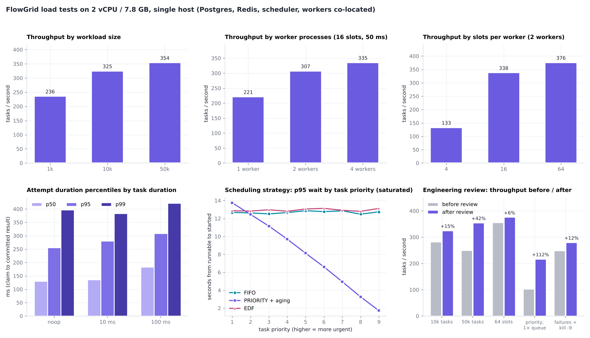

# FlowGrid benchmark report

Generated from `benchmark_results.json` (2026-11-12T18:38:00.660Z). Every figure below is computed from timestamps Postgres recorded during the run (task attempts, executions), not estimated by the load generator.

## Hardware and software

| | |
|---|---|
| CPU | Intel(R) Xeon(R) Processor @ 2.10GHz |
| Logical CPUs | 2 |
| Memory (GB) | 7.8 |
| OS | Linux 6.18.44-fc-v378 (x64) |
| Node.js | v22.23.4 |
| PostgreSQL | psql (PostgreSQL) 16.15 (Ubuntu 16.15-0ubuntu0.24.04.1) |
| Redis | v=7.0.15 |
| Postgres settings | shared_buffers=512MB, synchronous_commit=on, fsync=on (defaults otherwise) |
| Redis settings | appendonly yes (everysec) |
| Topology | everything on one machine: Postgres, Redis, scheduler process, worker processes and the load generator share the same CPUs |

This is a small, shared machine: Postgres, Redis, the scheduler, every worker process and the load generator compete for the same 2 vCPUs. Absolute numbers are therefore a floor, not a ceiling; the relative comparisons are the useful part.

## Methodology

- `node bench/run.ts` starts **one scheduler process and N worker processes** (`node src/main.ts`, the same entry point as production) against a dedicated database and Redis index, then submits work through `ExecutionService.start`.
- **Closed-loop scenarios** pre-load the whole backlog with a far-future start time, then release it in one statement at T0, so the measured window is pure execution: `window = last successful attempt finished − T0`.
- The **open-loop** latency scenario submits workflows at a steady rate with spare capacity, to show scheduling overhead when the system is not saturated.
- Workload: a fan-out/fan-in DAG (`start → 8 parallel tasks → join`, 10 tasks per workflow) of `core.sleep` tasks (simulated I/O), `core.noop` for pure engine overhead, and `core.notify` (a real database side effect behind an idempotency key) for the failure scenario.
- **Definitions.** *Attempt duration*: claim → result committed (handler time plus the commit). *Scheduling delay*: runnable → dispatched to the stream (includes waiting for worker capacity under backpressure). *Queue wait*: dispatched → started. *Task end-to-end*: runnable → succeeded. *Workflow completion*: released → workflow finished. *Utilisation*: Σ attempt durations ÷ (slots × window).
- CPU and memory are sampled once per second from `/proc` for the scheduler, the worker processes, all Postgres processes and Redis.

## Results

| Scenario | Tasks | Workers × slots | Task | Throughput (tasks/s) | Window | Attempt p50 / p95 / p99 | Sched. delay p95 | Workflow p95 | Utilisation | Peak parallel |
|---|---:|---|---|---:|---:|---|---:|---:|---:|---:|
| 1,000 tasks | 1,000 | 4 × 32 | core.sleep 10 ms | **236** | 4,238 ms | 193 ms / 366 ms / 483 ms | 1,903 ms | 4,200 ms | 39% | 104 |
| 10,000 tasks | 10,000 | 4 × 32 | core.sleep 10 ms | **325** | 30.79 s | 152 ms / 278 ms / 391 ms | 22.26 s | 30.71 s | 42% | 128 |
| 50,000 tasks | 50,000 | 4 × 32 | core.sleep 10 ms | **354** | 141.06 s | 138 ms / 266 ms / 375 ms | 104.36 s | 140.63 s | 42% | 109 |
| 1 worker | 10,000 | 1 × 16 | core.sleep 50 ms | **221** | 45.19 s | 55 ms / 68 ms / 78 ms | 33.29 s | 44.98 s | 78% | 16 |
| 2 workers | 10,000 | 2 × 16 | core.sleep 50 ms | **307** | 32.54 s | 60 ms / 87 ms / 111 ms | 23.70 s | 32.41 s | 60% | 32 |
| 4 workers | 10,000 | 4 × 16 | core.sleep 50 ms | **335** | 29.82 s | 78 ms / 130 ms / 182 ms | 21.45 s | 29.72 s | 44% | 64 |
| concurrency 4 | 5,000 | 2 × 4 | core.sleep 50 ms | **133** | 37.57 s | 53 ms / 58 ms / 63 ms | 27.86 s | 37.39 s | 89% | 8 |
| concurrency 16 | 10,000 | 2 × 16 | core.sleep 50 ms | **338** | 29.59 s | 58 ms / 78 ms / 103 ms | 21.73 s | 29.47 s | 64% | 32 |
| concurrency 64 | 10,000 | 2 × 64 | core.sleep 50 ms | **376** | 26.61 s | 173 ms / 246 ms / 303 ms | 19.40 s | 26.53 s | 52% | 128 |
| 0 ms (noop) | 10,000 | 4 × 32 | core.noop 0 ms | **358** | 27.97 s | 130 ms / 256 ms / 397 ms | 20.14 s | 27.88 s | 40% | 128 |
| 10 ms | 10,000 | 4 × 32 | core.sleep 10 ms | **353** | 28.30 s | 136 ms / 280 ms / 383 ms | 19.94 s | 28.22 s | 41% | 128 |
| 100 ms | 10,000 | 4 × 32 | core.sleep 100 ms | **349** | 28.63 s | 183 ms / 309 ms / 422 ms | 20.32 s | 28.55 s | 53% | 128 |
| FIFO | 3,000 | 1 × 8 | core.sleep 20 ms | **225** | 13.33 s | 27 ms / 32 ms / 36 ms | 12.67 s | 12.72 s | 77% | 8 |
| PRIORITY (+aging) | 3,000 | 1 × 8 | core.sleep 20 ms | **217** | 13.84 s | 27 ms / 34 ms / 40 ms | 13.20 s | 13.25 s | 76% | 8 |
| EDF | 3,000 | 1 × 8 | core.sleep 20 ms | **219** | 13.69 s | 27 ms / 34 ms / 40 ms | 12.97 s | 13.01 s | 76% | 8 |
| light load (open loop) | 2,000 | 2 × 16 | core.sleep 10 ms | **100** | 19.98 s | 16 ms / 21 ms / 23 ms | 29 ms | 129 ms | 5.1% | 9 |
| 10% failures + kill -9 | 10,000 | 4 × 16 | core.notify 20 ms | **280** | 35.73 s | 74 ms / 164 ms / 247 ms | 25.93 s | 35.51 s | 41% | 61 |

### Scheduling latency with spare capacity (open loop)

200 workflows (2,000 tasks) submitted evenly over 20 s to 2 workers × 16 slots.

| Measure | p50 | p95 | p99 | max |
|---|---:|---:|---:|---:|
| Scheduling delay (runnable → dispatched) | 6 ms | 29 ms | 36 ms | 80 ms |
| Queue wait (dispatched → started) | 6 ms | 10 ms | 14 ms | 32 ms |
| Attempt duration (10 ms task) | 16 ms | 21 ms | 23 ms | 36 ms |
| Task end-to-end | 29 ms | 47 ms | 58 ms | 96 ms |
| Workflow completion (10 tasks, 3 levels) | 101 ms | 129 ms | 151 ms | 164 ms |

### Scheduling strategies under saturation

Same backlog for each run: 3,000 single-task workflows with random priorities (1–9) and deadlines (5–125 s), one worker with 8 slots, 20 ms tasks, dispatch queue bounded at 1× capacity so ordering decides who waits.

| Strategy | Throughput | Wait p95, priority 1 | Wait p95, priority 9 | Deadline misses |
|---|---:|---:|---:|---:|
| FIFO | 225 tasks/s | 12.67 s | 12.74 s | 100 of 3,000 (3.3%) |
| PRIORITY (+aging) | 217 tasks/s | 13.74 s | 1,725 ms | 126 of 3,000 (4.2%) |
| EDF | 219 tasks/s | 12.86 s | 13.12 s | 0 of 3,000 (0.0%) |

### Failure injection and recovery

10,000 `core.notify` tasks (each writes a notification row behind an idempotency key), 10% injected transient failure rate per attempt, and **kill -9 of one of the 4 worker processes** once 40% of tasks had settled.

| Measure | Value |
|---|---:|
| Workflows succeeded | 1,000 of 1,000 |
| Failed attempts (injected) | 1,087 |
| Attempts orphaned by the killed worker | 11 |
| Tasks that needed a retry | 988 |
| Retry success rate | 100% |
| Dead-lettered tasks | 0 |
| Business-effect rows / distinct logical operations | 10,000 / 10,000 |
| Duplicate business-effect rate | 0.000% |
| Kill → all orphaned leases reaped | 3,423 ms |
| Kill → every orphaned task completed elsewhere | 3,844 ms |
| Throughput during the run | 280 tasks/s |

Worker timeout for this run was 3 s and the lease 5 s (`FLOWGRID_WORKER_TIMEOUT_MS`, `FLOWGRID_LEASE_MS`); recovery time is dominated by those two settings by design.

### Correctness checks on every run

| Scenario | Tasks succeeded more than once | Workflows finalised other than exactly once |
|---|---:|---:|
| 1,000 tasks | 0 | 0 |
| 10,000 tasks | 0 | 0 |
| 50,000 tasks | 0 | 0 |
| 1 worker | 0 | 0 |
| 2 workers | 0 | 0 |
| 4 workers | 0 | 0 |
| concurrency 4 | 0 | 0 |
| concurrency 16 | 0 | 0 |
| concurrency 64 | 0 | 0 |
| 0 ms (noop) | 0 | 0 |
| 10 ms | 0 | 0 |
| 100 ms | 0 | 0 |
| FIFO | 0 | 0 |
| PRIORITY (+aging) | 0 | 0 |
| EDF | 0 | 0 |
| light load (open loop) | 0 | 0 |
| 10% failures + kill -9 | 0 | 0 |

### CPU and memory (sampled each second)

| Scenario | Scheduler CPU avg | Workers CPU avg (all) | Postgres CPU avg (all) | Redis CPU avg | Workers peak RSS | Postgres peak RSS |
|---|---:|---:|---:|---:|---:|---:|
| 1,000 tasks | 11% | 60% | 114% | 5% | 508 MB | 2,171 MB |
| 10,000 tasks | 7.3% | 41% | 134% | 4.8% | 624 MB | 3,880 MB |
| 50,000 tasks | 5.9% | 34% | 143% | 4.7% | 632 MB | 8,091 MB |
| 1 worker | 12% | 23% | 96% | 4.1% | 156 MB | 1,948 MB |
| 2 workers | 10% | 34% | 127% | 4.7% | 314 MB | 2,588 MB |
| 4 workers | 7.7% | 42% | 134% | 4.9% | 625 MB | 4,118 MB |
| concurrency 4 | 13% | 23% | 65% | 3.3% | 312 MB | 1,515 MB |
| concurrency 16 | 10% | 34% | 128% | 4.9% | 311 MB | 2,652 MB |
| concurrency 64 | 9.5% | 35% | 133% | 5.1% | 312 MB | 2,612 MB |
| 0 ms (noop) | 7.4% | 42% | 135% | 4.9% | 628 MB | 4,154 MB |
| 10 ms | 7.6% | 44% | 133% | 4.9% | 625 MB | 3,972 MB |
| 100 ms | 7.4% | 43% | 136% | 4.8% | 621 MB | 4,007 MB |
| FIFO | 14% | 22% | 96% | 3.7% | 165 MB | 1,699 MB |
| PRIORITY (+aging) | 14% | 23% | 97% | 3.7% | 154 MB | 1,838 MB |
| EDF | 14% | 22% | 98% | 3.6% | 155 MB | 1,902 MB |
| light load (open loop) | 11% | 21% | 52% | 2.2% | 287 MB | 2,002 MB |
| 10% failures + kill -9 | 8.1% | 42% | 134% | 4.5% | 594 MB | 3,632 MB |

100% = one vCPU; the machine has 2. Postgres RSS includes shared buffers counted once per backend process, so it overstates real memory use.

## Engineering review: before and after

Throughput of the same scenarios before and after the hot-path changes described in `docs/engineering-review.md` (same machine, same harness, same settings).

| Scenario | Before (tasks/s) | After (tasks/s) | Change | Attempt p95 before → after |
|---|---:|---:|---:|---|
| 1,000 tasks | 210 | 236 | +13% | 416 ms → 366 ms |
| 10,000 tasks | 282 | 325 | +15% | 409 ms → 278 ms |
| 50,000 tasks | 249 | 354 | +42% | 393 ms → 266 ms |
| 1 worker | 214 | 221 | +4% | 68 ms → 68 ms |
| 2 workers | 265 | 307 | +16% | 94 ms → 87 ms |
| 4 workers | 337 | 335 | -0% | 131 ms → 130 ms |
| concurrency 4 | 130 | 133 | +2% | 59 ms → 58 ms |
| concurrency 16 | 313 | 338 | +8% | 80 ms → 78 ms |
| concurrency 64 | 355 | 376 | +6% | 275 ms → 246 ms |
| 0 ms (noop) | 349 | 358 | +2% | 281 ms → 256 ms |
| 10 ms | 348 | 353 | +1% | 294 ms → 280 ms |
| 100 ms | 343 | 349 | +2% | 311 ms → 309 ms |
| FIFO | 102 | 225 | +122% | 36 ms → 32 ms |
| PRIORITY (+aging) | 102 | 217 | +112% | 37 ms → 34 ms |
| EDF | 98 | 219 | +123% | 36 ms → 34 ms |
| light load (open loop) | 99 | 100 | +1% | 33 ms → 21 ms |
| 10% failures + kill -9 | 249 | 280 | +12% | 186 ms → 164 ms |

## Reading the numbers

- On this host Postgres is the bottleneck: it uses most of one vCPU in every saturated scenario, and adding worker processes beyond the point where Postgres saturates mostly adds contention. A dedicated database host, or batching more state transitions per transaction, is the next lever.
- Scheduling delay under saturation is dominated by backpressure: the scheduler deliberately keeps at most 2× fleet capacity dispatched, so the rest of a released backlog waits in Postgres (where it is durable and re-orderable) rather than in Redis.
- Tasks are I/O-shaped (`core.sleep`); CPU-bound handlers would scale with worker processes, not with concurrency per process (Node runs handlers on one event loop).

